<p align="center">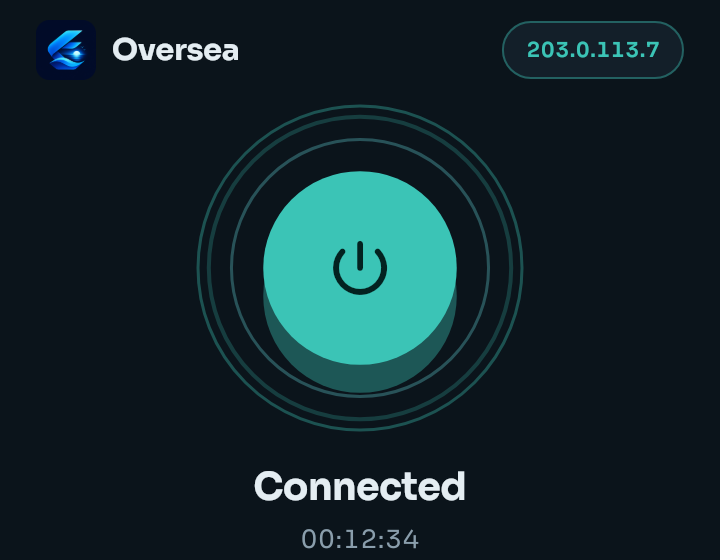</p>

# Oversea

**A fast, private VPN client for Android.** Add a config, tap once, and your phone's traffic goes through the server you chose. No account, no sign-up.

Oversea connects to servers that use **VLESS, VMess, Trojan or Shadowsocks** (Xray-core engine). You bring the config; Oversea gives you a clean way to store it, connect, measure it, and share it safely.

> **Status: beta.** The screenshots below are rendered from the app's own UI tests with sample data, not photos of a phone.

## Download

Get the latest APK from the **[Releases page](../../releases/latest)**.

| File | Use it on |
|---|---|
| `oversea-…-arm64-v8a.apk` | almost every phone made since 2017 (start here) |
| `oversea-…-armeabi-v7a.apk` | older 32-bit phones |
| `oversea-…-x86_64.apk` | emulators and some Chromebooks |
| `oversea-….apk` | universal build for any of the above (larger) |

Requires **Android 7.0 or newer**. Allow "install unknown apps" for your browser or file manager the first time. Updates install over the previous version.

## Screens

<table>
<tr>
<td align="center">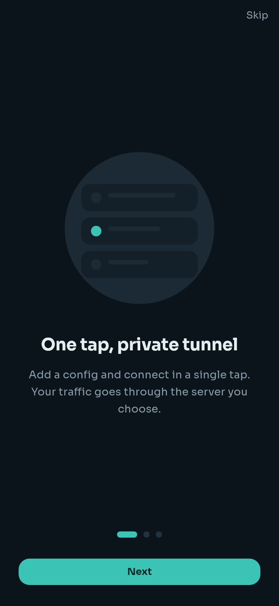<br><sub>Welcome</sub></td>
<td align="center">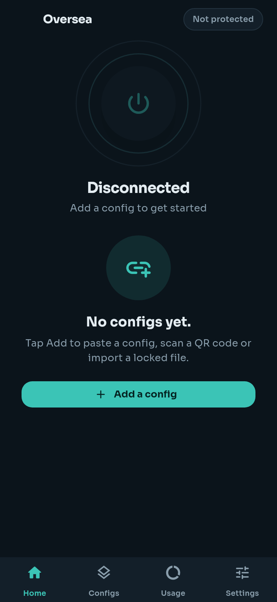<br><sub>Home, first start</sub></td>
<td align="center">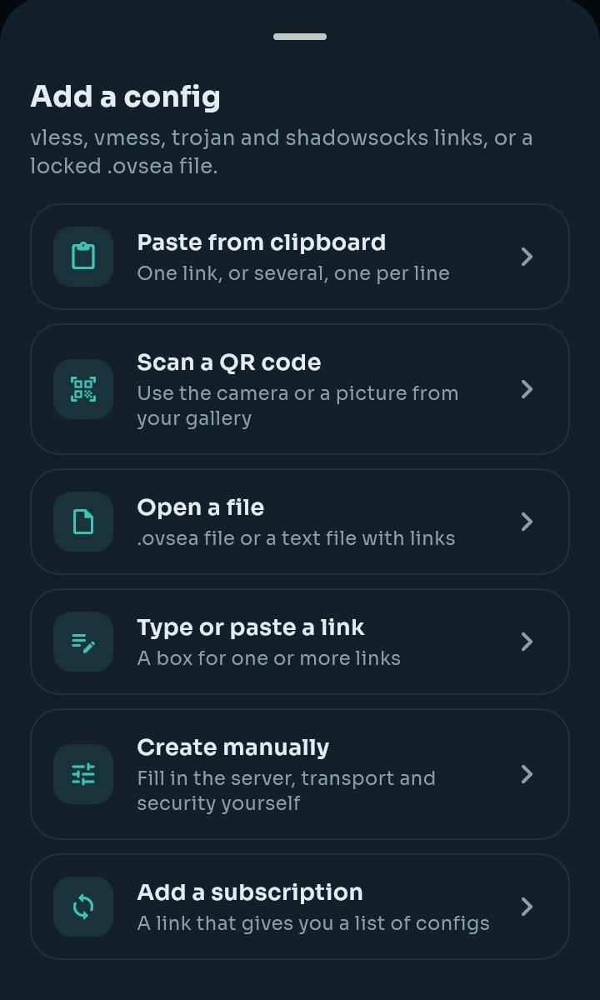<br><sub>Add a config</sub></td>
</tr>
<tr>
<td align="center">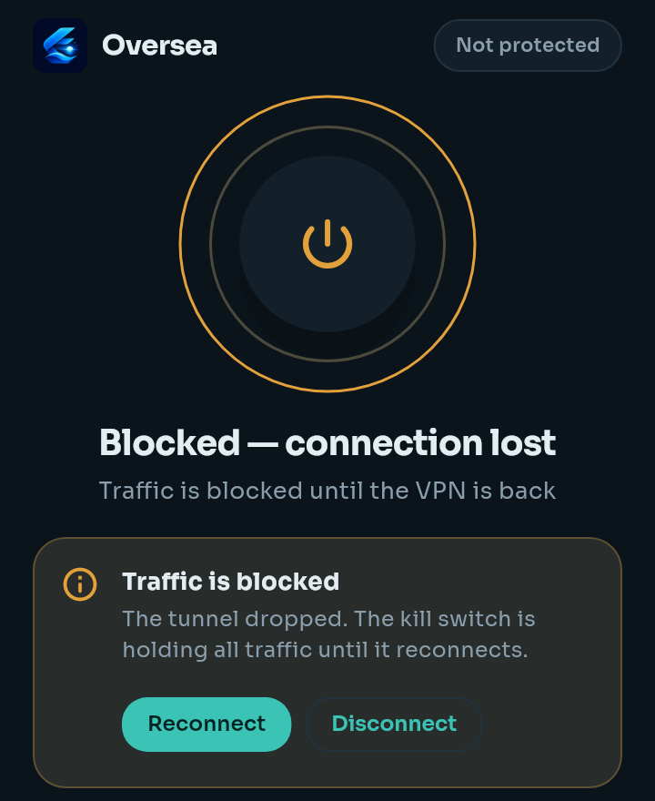<br><sub>Kill switch holding traffic</sub></td>
<td align="center">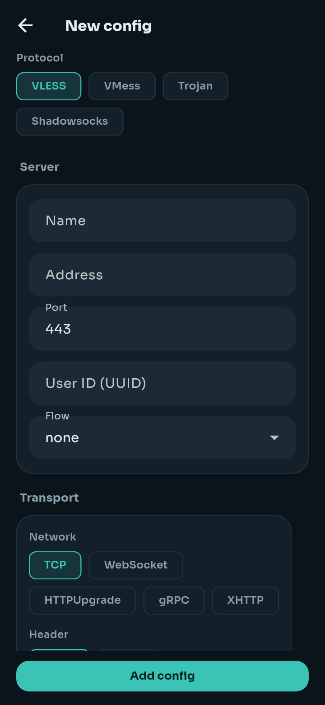<br><sub>Create a config by hand</sub></td>
<td align="center">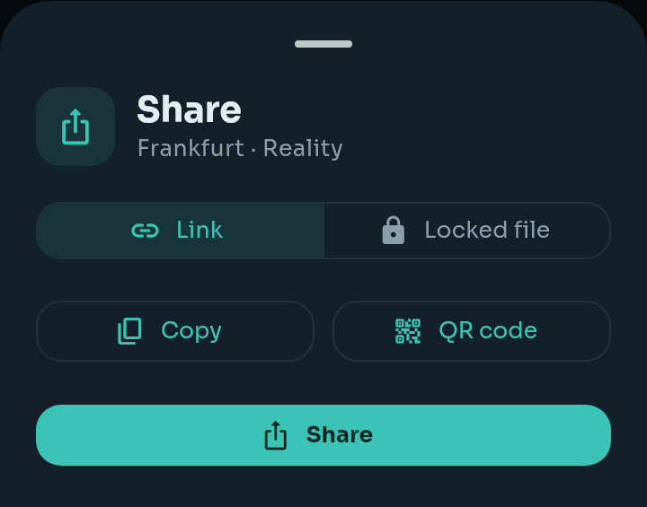<br><sub>Share a config</sub></td>
</tr>
<tr>
<td align="center">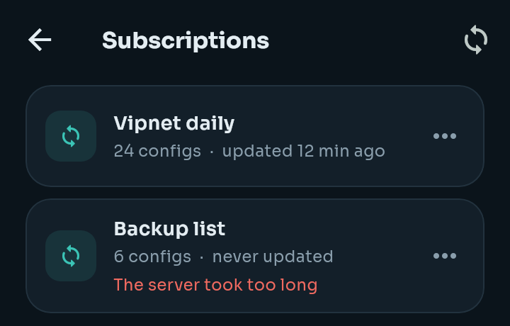<br><sub>Subscriptions</sub></td>
<td align="center">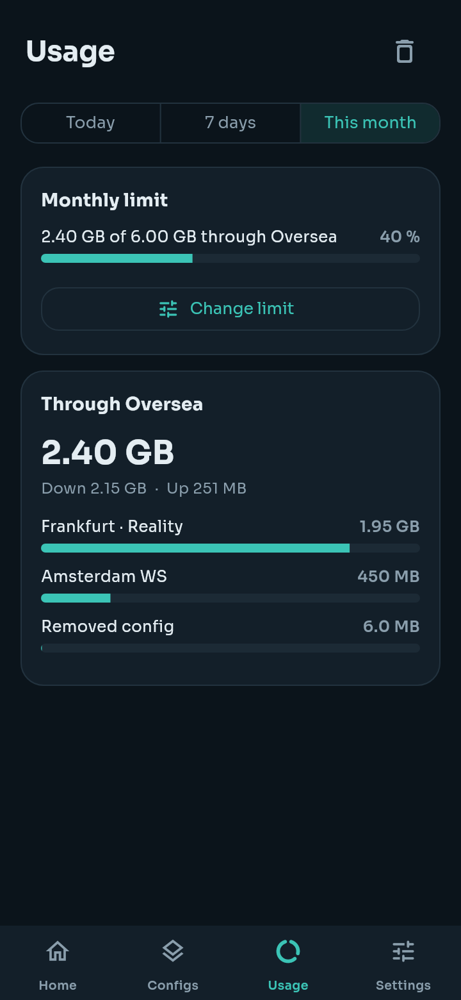<br><sub>Usage and monthly limit</sub></td>
<td align="center">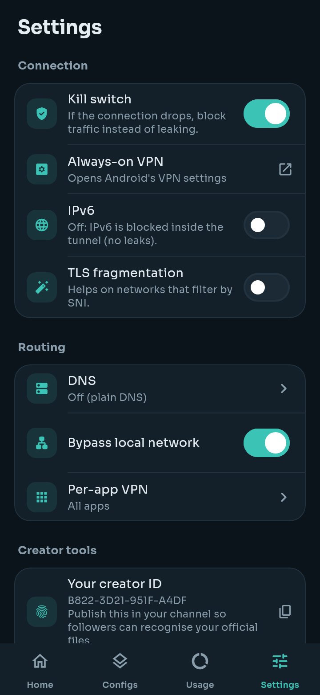<br><sub>Settings (dark)</sub></td>
</tr>
<tr>
<td align="center">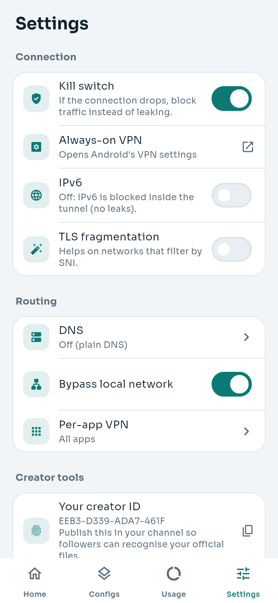<br><sub>Settings (light)</sub></td>
<td></td><td></td>
</tr>
</table>

## What the app does

### Home
- **One big button** to connect and disconnect. It shows the state (Disconnected, Connecting, Connected, Blocked), a session timer, and live download and upload speed with totals.
- **Exit check:** once connected, Oversea shows the exit IP and country, and whether **ChatGPT** and **Gemini** answer from that exit, so you can pick a config that works for them.
- **Auto fast mode:** one switch. When you connect, Oversea tests every config and joins the fastest.
- Your selected config is shown below with its protocol, ping and badges (*Not encrypted*, *Locked*, *Expired*).

### Adding configs
Open **Configs → Add**. You can:
- **Paste from clipboard**: one link or many, one per line.
- **Scan a QR code** with the camera or from a picture in your gallery.
- **Open a file**: a `.ovsea` file or a text file with links. Sharing a link or file *to* Oversea from another app also works ("Open with Oversea").
- **Type or paste a link** into a box.
- **Create manually**: choose the protocol (VLESS, VMess, Trojan, Shadowsocks), the server, the transport (TCP, WebSocket, HTTPUpgrade, gRPC, XHTTP) and the security options yourself. Errors are shown right in the form.
- **Add a subscription**: a link that gives you a list of configs.

### Configs
- All your configs in one list, with **Test speed** (ping one or all of them) and a switch between **Configs** and **Subscriptions**.
- Per-config menu: **Use this config**, **Test speed**, **Edit** (for configs you created or imported unlocked), **Share or lock**, **Delete**.
- A config that sends traffic without protocol encryption is marked **Not encrypted** so you know to avoid it for logins and payments.

### Subscriptions
- Reads the common subscription formats: plain or base64 link lists, Clash/Mihomo, sing-box, Xray JSON and SIP008.
- **Update now**, rename, delete. Updating shows a clear message when a server is slow or unreachable.
- Optional **automatic update every 12 hours** in the background, with a notification for new configs and when a subscription is about to end.

### Sharing and locked files
- **Link:** copy it, show a QR code, or send it with the Android share sheet.
- **Locked file:** export a config as a protected `.ovsea` file that only Oversea can open. Receivers can connect with it but cannot read or copy the server details. When you lock a file you can choose:
  - an **expiry**: 24 hours, 7 days, 30 days or never,
  - an **ad text** shown to whoever opens the file (labelled *Sponsored*),
  - your **Telegram channel** link.
- You can tie a lock to **your own server** so you can revoke it later (see the server tool below).
- Files show whether the **creator is verified, unverified or unsigned**. Trust the creators you know from Settings.

### Usage
- Counts the data that goes through Oversea, per config, for **today, the last 7 days, or this month**.
- Set an optional **monthly limit** and get notified at 80% and 100%.
- Everything stays on your phone. It needs no special Android permission.

### Settings
| Section | Option | What it does |
|---|---|---|
| Connection | **Kill switch** | If the connection drops, traffic is blocked instead of leaking. |
| | **Always-on VPN** | Opens Android's own VPN settings. |
| | **IPv6** | Off by default: IPv6 is blocked inside the tunnel so it cannot leak. |
| | **TLS fragmentation** | Helps on networks that filter by SNI. |
| Routing | **DNS** | Plain lookups through the tunnel, or encrypted DNS over HTTPS (Cloudflare, Google, Quad9). |
| | **Bypass local network** | Keeps your home or office network reachable. |
| | **Per-app VPN** | All apps, only the apps you select, or all apps except the ones you select. |
| Creator tools | **Your creator ID** | A short ID you can publish in your channel so followers recognise your official files. |
| | **Advanced** | Extra options for people who run their own server. |
| Privacy & ads | **Privacy policy**, **Ad privacy options** | The app shows ads (Google AdMob), with consent where required. |
| App | **Appearance** | System, Light or Dark. |
| | **Troubleshoot** | Checks your internet and clock, then tests the selected config and shows what failed. |

### Also on your phone
- **Quick Settings tile** and a **home-screen widget** to connect and disconnect without opening the app.
- A clear **disclosure screen** before Android asks for VPN permission, as Google Play requires.
- A connection notification while the VPN is active.

## For people who run a server

Oversea has an optional server companion, `oversee`, that can verify locked files and let you revoke them. Install or update it on a Linux server (amd64 or arm64), as root:

```bash
curl -fsSL https://github.com/OverSeeLabs/oversee-releases/releases/download/server-latest/install.sh | sudo bash
```

Run the same line again to update. Then run `sudo oversee` to open the manager. It has a built-in guide. Pin a version with `OVERSEE_VERSION=…`; remove it with `… | sudo bash -s -- --uninstall`.

## About this repository

This repository only hosts downloads (APKs, the server binary and its installer). There is no source code here.
